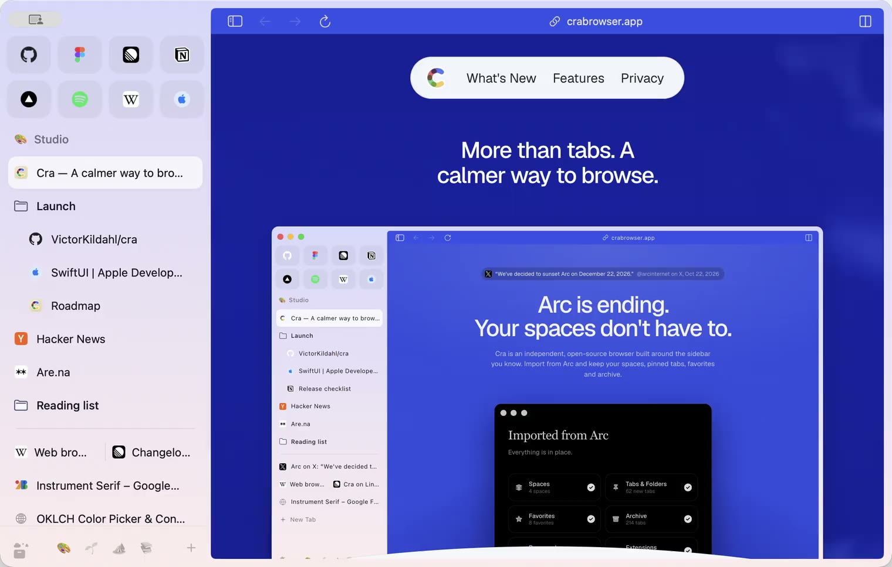

### Hi, I'm Victor 👋

Software engineer in Ribe. Right now I'm building **[Cra](https://github.com/VictorKildahl/cra)**, the open-source Arc replacement for macOS: spaces, pinned tabs, split view and Little Windows on Chromium, with your Arc sidebar imported in one go.

 

  

<h3 align="center">Cra</h3>

  Arc ends on 22 December 2026. Your spaces don't have to.

  
  
  

  

  
  &nbsp;
  

 

**Also made**

- [Spook](https://www.tryspook.com): SEO tools, with an [MCP server](https://github.com/VictorKildahl/spook-mcp) and a [drop-in Next.js blog](https://github.com/VictorKildahl/spook-nextjs-blog)
- [GhostWriter](https://github.com/VictorKildahl/ghostwriter-releases): a voice-powered ghostwriting app
